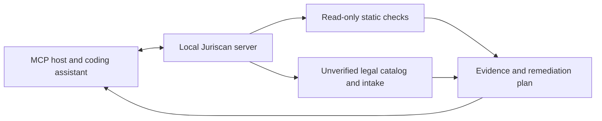

# Juriscan · Local MCP Server for Code Risk Review

**Evidence-based static analysis for AI coding assistants, with a local CLI and Model Context Protocol (MCP) server.**

Juriscan is a local, deterministic MCP server and CLI that finds selected risky code patterns, explains the evidence, and creates bounded remediation plans. Your existing coding assistant can use the results. Juriscan uses no LLM, API key, hosted inference, telemetry, or project-code upload.

**Status: 0.1.0-alpha.1 — technical preview, Linux / Node 24.** There are 12 tested static detectors, 25 MCP tools, JSON/Markdown/SARIF output, and a legal/industry research catalog. **Zero legally reviewed rulepacks are shipped.** This is not the complete v1 in the supplied specification and is not production legal clearance. See [coverage](docs/legal-coverage.md), [limitations](docs/limitations.md), and [release gates](docs/roadmap.md).

## Start locally

Prerequisites: Linux, Node **24.19.0**, pnpm **12.14.0**. Check out this repository, then run:

```sh
npm install --global pnpm@12.14.0
pnpm install --frozen-lockfile
pnpm build
pnpm test
pnpm smoke
node dist/cli.js scan --root fixtures/vulnerable --format markdown
node dist/cli.js scan --root fixtures/secure --format json
```

The first fixture yields 12 observations. The second yields zero for these patterns; neither fixture is a complete application. Nothing in either folder is executed. Build artifacts go into `dist/`; scans are read-only. No public npm installation command is advertised: this repository has not been published to npm.

## Connect an MCP host

Build first. Configure your host to launch:

```text
command: node
arguments: /absolute/path/to/Juriscan/dist/cli.js mcp --allow-root /absolute/path/to/your/project
```

The absolute allowed root is an operator-controlled boundary. A tool request cannot expand it. The official MCP SDK reference harness is tested over stdio in legacy negotiation and pinned `2026-07-28` negotiation. Individual Codex, Claude Code, Cursor, Gemini CLI, VS Code, Cline and Windsurf installations are **not yet validated**. Use your host's current configuration documentation; [integration notes](docs/clients.md) describe the tested protocol contract without inventing client commands.

Ask your host to:

1. Read `juriscan_capabilities` and collect facts using `juriscan_legal_intake`.
2. Call `juriscan_scan` with the authorized absolute `root`.
3. Page through `juriscan_findings` with the returned `scan_id`, and run `juriscan_ip_review` for copyright/license/asset questions.
4. Request `juriscan_remediation_plan` and `juriscan_generate_master_prompt` using that ID.
5. Review changes and run your application's tests separately. `juriscan_verify` only compares static observations.



## What runs today

| Area            | Implemented observations                                                                  |
| --------------- | ----------------------------------------------------------------------------------------- |
| Credentials     | Credential-shaped literals; privileged environment names in client modules                |
| Database access | Explicit SQL RLS disable; unconditional SQL policy; unconditional Firebase permission     |
| Data handling   | Sensitive named values in console calls; local-only deletion indicators                   |
| Tracking        | Known analytics/advertising imports or script references                                  |
| Payments        | Stripe webhook-shaped function parsing JSON without local signature verification          |
| JSX             | Missing image alternatives; missing source-visible input names; explicit opener isolation |

These are narrowly scoped observations. SQL/Firebase rules use bounded lexical checks; JavaScript/TypeScript uses the TypeScript parser. No detector proves a statutory violation or a live exploit. [Detector contracts](docs/detectors.md) state false-positive and false-negative boundaries.

## Industry and legal research

```sh
node dist/cli.js checklist --industries healthcare,education --features ai,subscriptions --jurisdictions EU,US-FED,IN
node dist/cli.js coverage
node dist/cli.js intake --answers '{"target_markets":{"state":"known","value":["EU","IN"]}}'
```

The catalog contains 201 research entries, including national/sector frameworks, U.S. states and territories, and EEA implementation gaps. Its 54 sector choices, 27 feature choices and 22 product archetypes support combinations **without claiming to enumerate every website, industry, jurisdiction or law**. Unknown markets remain explicit coverage gaps. Recommendations are research questions, not jurisdiction-qualified legal opinions. Every legal record is `research_preview` / `unverified`; no current-law effective dates, legal approval, or legal enforcement predicates are fabricated.

Primary-source URLs, retrieval outcomes and outstanding reviews live in [source-registry](source-registry/laws.json). Retrieval hashes prove only which response bytes were fetched, not legal accuracy. Some URLs are regulator research portals rather than exact statutory texts. [The supplied inventory](docs/supplied-research-backlog.md) remains a visible research backlog.

## Copyright and IP review

```sh
node dist/cli.js ip-review --root fixtures/secure
node dist/cli.js ip-web --root fixtures/secure --reference-url https://raw.githubusercontent.com/microsoft/TypeScript/main/LICENSE.txt --allow-domain raw.githubusercontent.com --authorize-network
```

Offline IP review flags license metadata, possible license-document disagreement, reciprocal-license questions, copyright notices, asset provenance and selected brand references. A separate opt-in tool compares approved public references using exact bytes and sampled text overlap, without uploading project content. It does **not** search the whole web or determine infringement. [IP review guide](docs/intellectual-property.md) covers game assets, trademarks, patents, trade dress, ownership, limitations and network safeguards.

## Reports and CI

```sh
node dist/cli.js scan --root fixtures/vulnerable --format sarif
node dist/cli.js scan --root fixtures/secure --fail-on high
node dist/cli.js prompt --root fixtures/vulnerable
```

Exit codes: `0` complete scan without selected gating observations, `1` confirmed technical severity threshold reached, `2` invalid arguments/configuration, `3` incomplete scan. The default is `--fail-on none`; heuristic and legal unknowns never fail a severity gate. Partial scans return `3` even with zero findings. [CLI reference](docs/cli-reference.md) and [CI](docs/ci-integration.md) explain limits and output handling.

## Safety and boundaries

Ordinary scans and offline IP reviews never execute project scripts or make network requests. Web-reference comparison is separate and requires explicit authorization. Symlinks are skipped, opened file descriptors are checked against authorized roots before reading, and bytes/files/findings/time are bounded. Findings contain trusted observation templates and file locations, not source excerpts or credential values. Repository evidence is untrusted data. The MCP host may transmit results to its model provider: review host settings too.

The scanner does not audit deployed systems, run browser/keyboard tests, review contracts, determine professional licensing, compute taxes, perform litigation research, or certify global legal compliance. No independent security audit or qualified legal review has been completed. A clean report is not proof that your application is secure or lawful. Read the [threat model](docs/threat-model.md).

## Contribute and license

Code is Apache-2.0; see [LICENSE](LICENSE) and [NOTICE](NOTICE). Third-party laws, standards, publisher content and trademarks retain their own rights. No legal-source text is redistributed as part of the catalog.

Read [CONTRIBUTING](CONTRIBUTING.md), [SECURITY](SECURITY.md), and [GOVERNANCE](GOVERNANCE.md). Report reproducible detector issues using synthetic examples; never post real secrets or customer data.

Juriscan identifies technical observations and research questions from limited evidence. It does not give legal advice, determine full legal compliance, or guarantee prevention of lawsuits, penalties, or security incidents. Disclaimers and an open-source license do not eliminate the maintainers' or users' legal obligations. Obtain qualified review for your actual business and jurisdictions.
